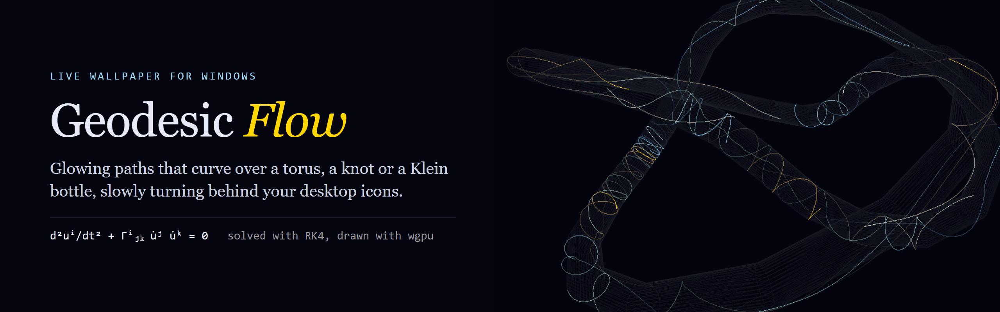
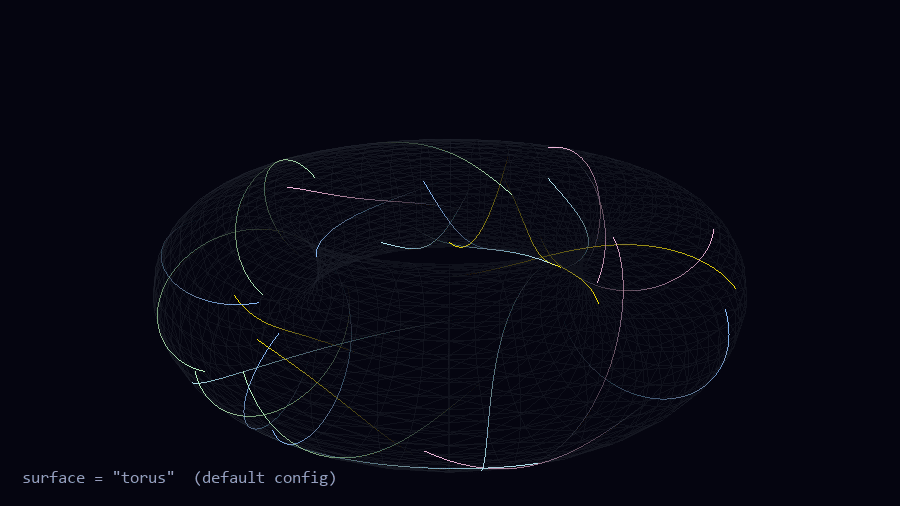
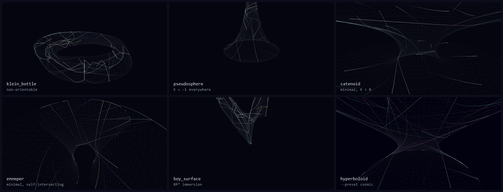

# geodesic-wallpaper

<!-- outcome-block -->
**A desktop that moves: glowing lines flowing over slowly turning 3D shapes behind your icons, installed with one PowerShell line.**

**Why this over the alternatives:** Paid wallpaper apps charge for this; geodesic-wallpaper is free and open source, and the installer checks the download's SHA-256.

**Guarantee:** if it doesn't do what this README says, [open an issue](https://github.com/Mattbusel/geodesic-wallpaper/issues) and I'll fix it.
<!-- outcome-block -->

**An animated wallpaper for Windows users: glowing lines flow over slowly turning 3D shapes (a donut, a knot, a Klein bottle) behind your desktop icons.**

<p align="center"></p>

<p align="center"></p>
<p align="center"><sub>Real frames from the app's own renderer (<code>--headless --record</code>), 15 fps. <a href="https://gitlab.com/mattbusel/geodesic-wallpaper/-/raw/master/assets/demo.mp4">Download the 15 s MP4</a>.</sub></p>

[](https://crates.io/crates/geodesic-wallpaper)
[](https://gitlab.com/mattbusel/geodesic-wallpaper/-/blob/master/LICENSE)

## Install (Windows 10 or 11)

| How | Command |
| --- | --- |
| **PowerShell one-liner** (easiest) | `irm https://gitlab.com/mattbusel/geodesic-wallpaper/-/raw/master/install.ps1 \| iex` |
| Scoop | `scoop bucket add mattbusel https://gitlab.com/mattbusel/scoop-bucket; scoop install mattbusel/geodesic-wallpaper` |
| Zip download | [Latest release](https://github.com/Mattbusel/geodesic-wallpaper/releases/latest): extract, run `geodesic-wallpaper.exe` |
| cargo-binstall (prebuilt) | `cargo binstall geodesic-wallpaper` |
| Cargo (build from source) | `cargo install geodesic-wallpaper` |

The one-liner checks the download's SHA-256, installs to `%LOCALAPPDATA%\Programs\geodesic-wallpaper`, adds it to your PATH and makes a Start Menu shortcut. It does not start the wallpaper. The exe is unsigned, so SmartScreen may say "unknown publisher": click **More info**, then **Run anyway**. Needs a GPU with DirectX 12 or Vulkan. There are no macOS or Linux builds: it is a Win32 desktop wallpaper.

## Use it in 3 steps

1. **Start it.** Open **Geodesic Wallpaper** from the Start Menu, or run `geodesic-wallpaper` in a terminal. After a photosensitivity notice (shown at each start; set `epilepsy_warning = false` in `config.toml` to skip it), the animation replaces your desktop background and sits behind your icons. A tray icon appears.
2. **Pick a look.** Run `geodesic-wallpaper --preset ocean` (also `cosmic`, `fire`, `matrix`, `neon`), or open `config.toml` next to the exe, change `surface = "torus"` to `"torus_knot"`, `"klein_bottle"`, `"pseudosphere"` and so on, and save. The running wallpaper reloads the file by itself.
3. **Stop it.** Right-click the tray icon and choose **Quit**. Your normal wallpaper comes back.

Want a still or a clip without touching your desktop? Headless mode renders offscreen, straight to files:

```powershell
geodesic-wallpaper --headless --output shot.png        # one 1920x1080 PNG
geodesic-wallpaper --headless --frames 240 --record frames --record-start 150 --record-every 2
ffmpeg -framerate 15 -i frames/frame_%05d.png -pix_fmt yuv420p clip.mp4

# or write the clip directly: GIF (no ffmpeg), full-colour APNG, or MP4 (pipes to ffmpeg)
geodesic-wallpaper --headless --width 480 --height 270 --frames 120 --record-start 60 --record-every 2 --gif loop.gif --apng loop.png --mp4 clip.mp4
```

That last command, run for this release on Windows 11:

```text
Wrote 30-frame GIF (480x270, 15 fps) to loop.gif
Wrote 30-frame APNG (480x270, 15 fps) to loop.png
Wrote 30-frame MP4 (480x270, 15 fps) to clip.mp4
```

The GIF was 425 KB (256 colours per frame), the APNG 2.4 MB (exact colours, plays in every current browser), the MP4 59 KB.

## Results

Six of the fourteen surfaces, rendered today by headless mode at 960x540 with the default palette (the GIF above shows four more):

<p align="center"></p>

Real output of the recording command (the frames behind the GIF):

```text
> geodesic-wallpaper --headless --frames 240 --record rec_torus --record-start 150 --record-every 2 --width 900 --height 506
Recorded 45 frames (900x506) to rec_torus
Make a video: ffmpeg -framerate 15 -i rec_torus/frame_%05d.png -pix_fmt yuv420p out.mp4
```

Each line is one particle sliding along the surface under the geodesic equation, integrated with RK4 (Christoffel symbols are exact formulas for the classic surfaces and central finite differences for the Klein bottle, Boy's surface, ellipsoid, torus knot and trefoil); the trail behind it fades by a power law. On a sphere the paths close into great circles, on a torus they wind forever without repeating, and on the pseudosphere neighbours spread apart exponentially.

## What it does

- **Fourteen surfaces**: torus, sphere, saddle, catenoid, helicoid, hyperboloid, hyperbolic paraboloid, ellipsoid, Enneper, Klein bottle, Boy's surface, torus knot, pseudosphere and trefoil tube.
- **Behaves like a wallpaper**: a borderless window pinned below all apps, so icons stay clickable. Primary monitor, a chosen monitor, or all of them.
- **Live config**: edit `config.toml` and save; the change shows up without a restart. Five presets ship in `presets/`.
- **Offscreen rendering** to PNG, PPM, BMP or SVG, numbered PNG frames for videos, or a looping animated GIF, with no window at all.
- **A Rust library** too: the surfaces and the RK4 integrator work on their own ([docs.rs](https://docs.rs/geodesic-wallpaper)).

<details>
<summary><b>Configuration reference (<code>config.toml</code>)</b></summary>

All fields are optional. Missing fields revert to the defaults shown.

Place `config.toml` in the same directory as the executable. The file is hot-reloaded automatically whenever it changes on disk, no restart required.

| Field | Type | Default | Description |
|-------|------|---------|-------------|
| `surface` | string | `"torus"` | Surface to render. See [Supported surfaces](#supported-surfaces). |
| `num_geodesics` | integer | `30` | Number of simultaneous geodesic curves. |
| `trail_length` | integer | `300` | Frames a trail persists before respawning. |
| `rotation_speed` | float | `0.001047` | Camera orbit speed in radians per second. |
| `color_palette` | string[] | 5 entries | CSS hex colour strings cycled across geodesics. |
| `torus_R` | float | `2.0` | Torus major radius (centre to tube centre). |
| `torus_r` | float | `0.7` | Torus minor radius (tube radius). |
| `time_step` | float | `0.016` | RK4 integration timestep in seconds per frame. |
| `catenoid_c` | float | `1.0` | Catenoid scale parameter. |
| `helicoid_c` | float | `1.0` | Helicoid pitch parameter. |
| `hyperboloid_a` | float | `1.0` | Hyperboloid semi-axis a. |
| `hyperboloid_b` | float | `1.0` | Hyperboloid semi-axis b. |
| `ellipsoid_a` | float | `2.0` | Ellipsoid semi-axis along x. |
| `ellipsoid_b` | float | `1.5` | Ellipsoid semi-axis along y. |
| `ellipsoid_c` | float | `1.0` | Ellipsoid semi-axis along z. |
| `hyperbolic_paraboloid_a` | float | `1.0` | Saddle+ semi-axis a. |
| `hyperbolic_paraboloid_b` | float | `1.0` | Saddle+ semi-axis b. |
| `camera_distance` | float | `6.0` | Camera distance from origin. |
| `camera_elevation` | float | `0.4` | Camera elevation in radians. |
| `camera_fov` | float | `0.8` | Vertical field-of-view in radians. |
| `show_wireframe` | bool | `true` | Render surface wireframe mesh. |
| `trail_fade_power` | float | `2.0` | Exponent for trail alpha fade (1=linear, 2=quadratic). |
| `target_fps` | integer | `30` | Target frame rate. |
| `background_color` | string | `"#050510"` | Background clear colour as CSS hex. |
| `color_mode` | string | `"cycle"` | `"cycle"` or `"random"` colour assignment. |
| `monitor` | string | `"primary"` | `"primary"`, `"all"` (span every monitor) or a monitor index such as `"1"`. |

Minimal example:

```toml
surface          = "torus"
num_geodesics    = 30
trail_length     = 300
rotation_speed   = 0.001047
background_color = "#050510"
color_palette    = ["#4488FF", "#88DDFF", "#FFD700", "#88FF88", "#FF88CC"]
```

`config.toml` and `presets/` are read from the current folder first, then from the folder that holds the exe.

</details>

<details>
<summary><b>Command-line flags</b></summary>

| Flag | Effect |
| --- | --- |
| `--preset NAME` | Merge `presets/NAME.toml` over `config.toml` |
| `--headless [--frames N] [--output FILE] [--output-format png\|ppm\|bmp\|svg]` | Simulate N frames offscreen (no window) and save the last one |
| `--record DIR [--record-start N] [--record-every N]` | With `--headless`: also save frames as `DIR/frame_00000.png`, ... |
| `--gif FILE` | With `--headless`: write the recorded frames (same `--record-start` / `--record-every` schedule) as a looping GIF at 30 / every fps |
| `--apng FILE` | Same, as a looping animated PNG (full colour) |
| `--mp4 FILE [--ffmpeg PATH]` | Same, as an H.264 MP4 by piping frames to ffmpeg (install it separately, for example `winget install Gyan.FFmpeg`) |
| `--completions SHELL` | Print a completion script for bash, zsh, fish, powershell or elvish |
| `--width N --height N` | Size of headless renders (default 1920x1080) |
| `--preview` | Print an ASCII block preview of the pattern and exit |
| `--animate [--frames N] [--fps N] [--out-dir DIR]` | Exercise the frame exporter; writes gradient test frames, not wallpaper renders |
| `--palette TYPE[:HUE] [--palette-steps N]` | Print a generated palette (rainbow, monochromatic, complementary, triadic, analogous) |
| `--gradient`, `--colorspace`, `--fractal`, `--tile` | Print diagnostics from the gradient, color space, fractal and tiling modules, then exit |
| `--version`, `--help` | Version, and help with examples |

Set `NO_COLOR=1` for plain log output and `RUST_LOG=debug` for more detail.

</details>

<details>
<summary><b>Keyboard and tray</b></summary>

| Key | Action |
| --- | --- |
| `]` / `[` | Next / previous surface |
| `+` / `-` | Speed up / slow down |
| `R` | Reset all geodesics |
| `F` | Toggle FPS overlay |
| `Space` | Pause |
| `P` | Save a screenshot |

The wallpaper window is created so that it never steals focus, so the tray menu (right-click the tray icon) is the dependable way to switch surface or quit.

</details>

<details>
<summary><b>Supported surfaces</b></summary>

All surfaces implement the `Surface` trait: `position()`, `normal()`, `metric()`, `christoffel()`, `wrap()`, `random_position()`, `random_tangent()`, and `mesh_vertices()`.

| Surface | Config name | Curvature | Notes |
||-|--|-|
| Torus | `"torus"` | Mixed | Analytic Christoffels; ergodic irrational windings |
| Sphere | `"sphere"` | Constant positive K = 1/R² | All geodesics are great circles |
| Saddle | `"saddle"` | Zero (flat chart) | Straight-line geodesics |
| Catenoid | `"catenoid"` | Negative (minimal) | Geodesics spiral around the waist |
| Helicoid | `"helicoid"` | Negative (minimal) | Isometric to catenoid |
| Hyperboloid | `"hyperboloid"` | Negative | One-sheeted ruled quadric |
| Hyperbolic paraboloid | `"hyperbolic_paraboloid"` | Negative | Doubly ruled; z = u²/a² − v²/b² |
| Ellipsoid | `"ellipsoid"` | Positive (varying) | Three independent semi-axes |
| Enneper | `"enneper"` | Negative (minimal) | Complete; total curvature −4π; self-intersects |
| Klein bottle | `"klein_bottle"` | Non-orientable | Figure-8 immersion in ℝ³ |
| Boy's surface | `"boy_surface"` | Non-orientable | RP² with 3-fold symmetry (Apery form) |
| Torus knot | `"torus_knot"` | Positive (tube) | Default T(2,3) trefoil |
| **Pseudosphere** | `"pseudosphere"` | **Constant negative K = −1** | Tractricoid; geodesics diverge exponentially; the hyperbolic plane's classic model surface |
| **Trefoil tube** | `"trefoil"` | Positive (tube) | Circular cross-section swept around the trefoil knot curve; geodesics precess across all three lobes |

</details>

<details>
<summary><b>The math</b></summary>

#### Geodesic equations

On a Riemannian surface with metric `g_{ij}` a geodesic `γ(t)` satisfies:

```
d²uⁱ/dt² + Γⁱⱼₖ (duʲ/dt)(duᵏ/dt) = 0
```

where `Γⁱⱼₖ = ½ gⁱˡ (∂ⱼgₗₖ + ∂ₖgₗⱼ − ∂ₗgⱼₖ)` are the Christoffel symbols of the second kind. The torus, sphere, saddle, catenoid, helicoid, hyperboloids, Enneper surface and pseudosphere implement `christoffel()` with exact formulas. The Klein bottle, Boy's surface, ellipsoid, torus knot and trefoil tube use central finite differences of the metric.

#### Curvature comparison

| Surface | Gaussian curvature K | Geodesic character |
|||-|
| Sphere | K = +1/R² (constant) | Great circles: all geodesics are closed |
| Torus | Mixed (positive outer, negative inner) | Depends on winding ratio: rational = periodic, irrational = dense (ergodic) |
| Saddle / flat | K = 0 | Straight lines in parameter space |
| Catenoid / helicoid | K < 0 (minimal) | Geodesics spiral and diverge |
| Pseudosphere | K = −1 (constant) | Maximal divergence: model of the hyperbolic plane |
| Hyperboloid | K < 0 | Asymptotic geodesics along the rulings |

#### Gauss-Bonnet theorem

For any compact surface `Σ` without boundary:

```
∬_Σ K dA = 2π χ(Σ)
```

where `χ` is the Euler characteristic. This connects the local curvature of each built-in surface to its global topology (sphere: χ=2, torus: χ=0, Klein bottle: χ=0, RP²: χ=1).

</details>

<details>
<summary><b>Architecture and library use</b></summary>

| Module | Responsibility |
| --- | --- |
| `surface/` | `Surface` trait and the fourteen implementations, plus procedural and user-defined surfaces |
| `geodesic` | RK4 integrator for the geodesic ODE |
| `trail` | Fixed-capacity ring buffer with power-law alpha fade |
| `renderer/` | wgpu pipelines and WGSL shaders for the surface wireframe and trails, camera |
| `wallpaper` | Win32 window pinned below app windows, keyboard input, monitor enumeration |
| `config` | `config.toml` loading, profiles and hot reload |
| `tray` | System tray icon |
| `main` | CLI, message loop, render loop, headless path |

The crate is also a library (`geodesic_wallpaper`) with a large set of additional modules that are unit tested but **not yet wired into the wallpaper binary**: gallery mode, a live parameter tuner, phase portrait recording, mouse-driven geodesic shooting, a geodesic field (basin) view, per-monitor surface assignment, a financial OHLCV data driver, Lua-scripted surfaces (`--features lua`), scene presets, and generative-art modules (wallpaper symmetry groups, Penrose and Escher tilings, reaction-diffusion, L-systems, strange attractors, Voronoi, fractals, color spaces and export formats). Their `config.toml` keys (for example `gallery_mode`) parse but currently have no effect on the running wallpaper.

</details>

## Use it as a library

```sh
cargo add geodesic-wallpaper
```

Follow one geodesic around a torus (this is [`examples/follow_geodesic.rs`](examples/follow_geodesic.rs); run it with `cargo run --example follow_geodesic`):

```rust
use geodesic_wallpaper::geodesic::Geodesic;
use geodesic_wallpaper::surface::{torus::Torus, Surface};

fn main() {
    let torus = Torus::new(2.0, 0.7);
    // Start at (u, v) = (0, 0) heading in direction (1, 0.3); live 300 steps.
    let mut g = Geodesic::new(0.0, 0.0, 1.0, 0.3, 300, 0);
    for step in 0..=100 {
        if step % 25 == 0 {
            let p = torus.position(g.u, g.v);
            println!("step {step:3}: ({:+.3}, {:+.3}, {:+.3})", p.x, p.y, p.z);
        }
        g.step(&torus, 0.016); // one RK4 step of the geodesic equation
    }
}
```

More examples, none of which open a window:

| Example | What it shows |
| --- | --- |
| `cargo run --example follow_geodesic` | The snippet above |
| `cargo run --example custom_surface` | A surface from a typed formula (`sin(sqrt(x^2 + y^2) * 3) * ...`), and what bad formulas return |
| `cargo run --example trails_to_gif` | Twelve geodesics on a torus drawn on the CPU and saved as a GIF and an APNG |

### Cargo features

| Feature | Default | What it adds |
| --- | --- | --- |
| `lua` | off | `lua_surface::LuaSurface`: define a surface's metric in a Lua script (Lua 5.4 is compiled in via `mlua`, so a C compiler is needed) |
| `palette` | off | `From` conversions between this crate's `Rgb`, `Lab` and `Oklab` and the [`palette`](https://crates.io/crates/palette) crate's types |

Already using `palette`? Turn on the feature and convert either way:

```rust,ignore
let ours: geodesic_wallpaper::colorspace::Rgb = palette::Srgb::new(255u8, 128, 0).into();
let back: palette::Srgb<u8> = ours.into();
```

The hand-written Lab and Oklab conversions are checked against `palette` in the test suite (4,913 colours; Oklab within 0.001, Lab within 0.05).

### Performance

`cargo bench --bench simulation` times the CPU work of one frame (30 geodesics, 300-point trails: RK4 step, trail update, flatten for upload). Same bench file, built against 1.5.1 and 1.6.0 on an i7-13700KF:

| Surface | 1.5.1 | 1.6.0 |
| --- | --- | --- |
| torus | 110.9 µs | 28.4 µs |
| sphere | 105.1 µs | 29.8 µs |
| pseudosphere | 122.1 µs | 40.4 µs |
| Klein bottle | 193.3 µs | 106.7 µs |

The gain is in trail flattening (no modulo or `powf` per vertex, no allocation per trail); the RK4 step itself is unchanged. A whole `--headless` run (1280x720, 300 frames, 50 PNGs) takes the same time (about 0.75 s, mostly GPU start-up and PNG encoding) and the same peak memory (243 MB) in both versions, and writes byte-identical images.

### Why this and not ...

- **Wallpaper Engine / Lively**: full wallpaper platforms with workshops of content. geodesic-wallpaper is one free, open-source program that generates its own animation from maths; there is nothing to download or subscribe to.
- **[bevy_live_wallpaper](https://crates.io/crates/bevy_live_wallpaper)**: a Bevy plugin for building your own live wallpaper. Use it if you are writing a Bevy app; use this if you want a finished wallpaper, or geodesic maths as a small library.

## Build from source

```powershell
git clone https://gitlab.com/mattbusel/geodesic-wallpaper.git
cd geodesic-wallpaper
cargo run --release                      # the live wallpaper, reads ./config.toml
cargo run --release -- --headless --output shot.png
cargo test --lib                         # no GPU needed
```

Contributing: [CONTRIBUTING.md](https://gitlab.com/mattbusel/geodesic-wallpaper/-/blob/master/CONTRIBUTING.md). Changes: [CHANGELOG.md](https://gitlab.com/mattbusel/geodesic-wallpaper/-/blob/master/CHANGELOG.md).

## License

MIT, see [LICENSE](https://gitlab.com/mattbusel/geodesic-wallpaper/-/blob/master/LICENSE).
